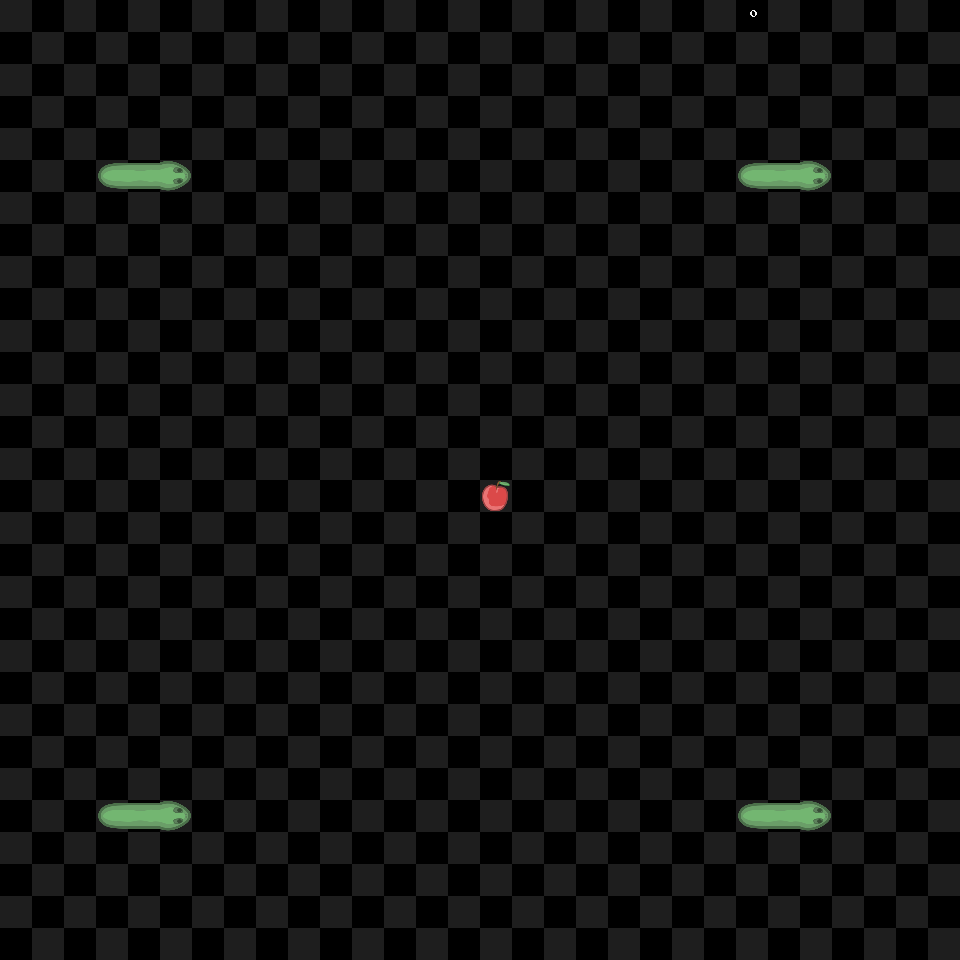

# Červy

A small Pygame multiplayer snake game for up to four players. Originally written
for Programming II by Samuel Koribanič.



## Run

Requires Python 3.10+.

```sh
python3 -m venv .venv
source .venv/bin/activate
python -m pip install -r requirements.txt
python server.py
```

In another terminal, from this folder:

```sh
source .venv/bin/activate
python main.py
```

On Windows, activate with `.venv\Scripts\activate`.
Click **Play**, open another client for each player, then press **Space** to start.
WASD or arrow keys steer; Escape exits. One client also works for solo practice.
The window title shows your player number and the match status.

For LAN play, run `python server.py 0.0.0.0` on the host and
`python main.py HOST_IP` on each client. Both commands accept `--port 5555`.
New players join a waiting room; full rooms and running matches get a separate
room. A disconnect leaves the other players connected. After a round, press
Space again.

## Implementation

The server moves every worm together at 250 ms intervals and handles food,
collisions, and round resets. Clients send input once per frame using
length-prefixed JSON messages. Use the same version for the server and clients;
the original pickle protocol is no longer supported. The server needs only the
Python standard library and does not open a window.

The original sprites, checkerboard, colors, and movement speed are preserved.
The board and sprites are cached; unchanged snapshots reuse existing blocks.
A local four-player benchmark reduced update/draw work from about 0.51 ms to
0.10 ms per frame. This excludes networking, display updates, and the 60 FPS cap.

## Checks

```sh
python -m unittest discover -s tests -v
python tools/benchmark.py --preview docs/preview.png
```

Tests cover simultaneous collisions, food placement, turns, split TCP messages,
room allocation, disconnects, key bindings, and headless rendering.
The original Slovak documentation is in [Dokumentácia.pdf](Dokumentácia.pdf).
